<a href="https://hexarch.me">
  <picture>
    <source media="(prefers-color-scheme: dark) and (min-width: 1140px)" srcset="assets/header-dark.svg">
    <source media="(prefers-color-scheme: dark)" srcset="assets/header-compact-dark.svg">
    <source media="(max-width: 1139px)" srcset="assets/header-compact-light.svg">
    
  </picture>
</a>

 

I build **internal developer platforms** — the layer that lets product teams ship without each of them reinventing networking, databases and tooling. Most of it is Go, and most of it sits one level below what users see.

### What I work on

- **Service mesh and traffic control** — one platform offering instead of several separate meshes. A service onboards in a single action; rate limits, timeouts and circuit breakers change at runtime, without a redeploy.
- **DBaaS** — cluster provisioning with full lifecycle management and an SDK that ships metrics out of the box. Provisioning takes minutes instead of days.
- **Agent infrastructure** — an MCP gateway in front of per-domain MCP servers: stateless, with tool search and scope-based authorization, so AI coding agents can reach internal infrastructure safely.
- **Developer tooling** — the small, sharp tools that hold the rest together.

### Stack

  <picture>
    <source media="(prefers-color-scheme: dark) and (min-width: 1140px)" srcset="assets/stack-dark.svg">
    <source media="(prefers-color-scheme: dark)" srcset="assets/stack-compact-dark.svg">
    <source media="(max-width: 1139px)" srcset="assets/stack-compact-light.svg">
    
  </picture>

### Projects

  <a href="https://github.com/HexArchy/porovnu"><picture><source media="(prefers-color-scheme: dark)" srcset="assets/card-porovnu-dark.svg"></picture></a>
  <a href="https://github.com/HexArchy/hexbridge"><picture><source media="(prefers-color-scheme: dark)" srcset="assets/card-hexbridge-dark.svg"></picture></a>
  <a href="https://github.com/HexArchy/memecam"><picture><source media="(prefers-color-scheme: dark)" srcset="assets/card-memecam-dark.svg"></picture></a>
  <a href="https://github.com/HexArchy/itmo-calendar"><picture><source media="(prefers-color-scheme: dark)" srcset="assets/card-itmo-calendar-dark.svg"></picture></a>
  <a href="https://github.com/HexArchy/goimporter"><picture><source media="(prefers-color-scheme: dark)" srcset="assets/card-goimporter-dark.svg"></picture></a>
  <a href="https://github.com/HexArchy/onec-conf-fetcher"><picture><source media="(prefers-color-scheme: dark)" srcset="assets/card-onec-conf-fetcher-dark.svg"></picture></a>

<a href="https://hexarch.me">
  <picture>
    <source media="(prefers-color-scheme: dark) and (min-width: 1140px)" srcset="assets/site-dark.svg">
    <source media="(prefers-color-scheme: dark)" srcset="assets/site-compact-dark.svg">
    <source media="(max-width: 1139px)" srcset="assets/site-compact-light.svg">
    
  </picture>
</a>

 

Background in information security: ITMO University, CTF — attack–defense and HackTheBox. It shows up less as a job title and more in how I design authorization and platform boundaries.

<code>remote · UTC+5</code> &nbsp;·&nbsp; <a href="https://hexarch.me">hexarch.me</a>

